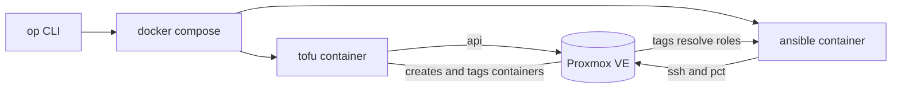

# pve-homeserver

[](https://github.com/alexgrist/pve-homeserver/actions/workflows/ansible-ci.yml)
[](https://github.com/alexgrist/pve-homeserver/actions/workflows/terraform-ci.yml)
[](https://github.com/alexgrist/pve-homeserver/actions/workflows/lint.yml)

Terraform + Ansible for my Proxmox homelab. Terraform creates the LXC containers, Ansible configures them.

## Architecture



Terraform owns the lifecycle, Ansible owns the configuration for anything running. The handover between them is tags: containers are tagged with their purpose, and Ansible applies the role that matches each tag. 1Password is the source for api tokens, vault and connection credentials, and neither toolchain reads them off disk.

## Prerequisites:

- Proxmox VE 8.4+ with API access
- Docker Compose
- 1Password CLI
- OpenTofu >= 1.12 (or use tofu container)

## Setup

1. Copy `.env.example` to `.env` and fill with Proxmox connection details or use a 1Password Environment.
2. Set `OP_SERVICE_ACCOUNT_TOKEN` in the host shell.
3. Build containers with `docker compose build`.

## Terraform

Two environments live under `terraform/environments/` each with its own state, variables, and container definitions.
Containers are YAML files under `<environment>/containers`. Ansible roles are applied based on Proxmox tags.

## Ansible

Playbooks live in `ansible/playbooks/`, inventories under `ansible/inventories/`. Hosts are grouped by Proxmox tags, roles matching those tags are applied on top of the shared common role. A container tagged `couchdb` gets the `couchdb` role automatically. The vault password (if provided) is fetched from 1Password at run time.

## Usage

Terraform and Ansible run through the compose toolchains, wrapped in an op session with `OP_ENV` (`--environment=<op_env_id>`, `OP_SERVICE_ACCOUNT_TOKEN` still needs to be in the shell).

### Terraform

```powershell
# initialise the working directory
op run --environment=<op_env_id> -- docker compose run --rm -e OP_SERVICE_ACCOUNT_TOKEN tofu tofu -chdir=/workspace/environments/development init

# create and save the execution plan
op run --environment=<op_env_id> -- docker compose run --rm -e OP_SERVICE_ACCOUNT_TOKEN tofu tofu -chdir=/workspace/environments/development plan -out planout

# apply the saved execution plan
op run --environment=<op_env_id> -- docker compose run --rm -e OP_SERVICE_ACCOUNT_TOKEN tofu tofu -chdir=/workspace/environments/development apply "planout"
```

### Ansible

```powershell
# list the development inventory
op run --environment=<op_env_id> -- docker compose run --rm ansible ansible-inventory -i inventories/development/hosts.proxmox.yml --list

# push the development playbook
op run --environment=<op_env_id> -- docker compose run --rm ansible ansible-playbook -i inventories/development/hosts.proxmox.yml playbooks/development.yml

# push the site playbook
op run --environment=<op_env_id> -- docker compose run --rm ansible ansible-playbook -i inventories/production/hosts.proxmox.yml playbooks/site.yml

# run the local test playbook (in local container)
op run --environment=<op_env_id> -- docker compose run --rm ansible ansible-playbook -i inventories/development/local.yml playbooks/local.yml
```

On Linux, the same commands are wrapped as make targets (see `make help`): `tf-init`, `tf-plan OP_ENV=...`, `tf-apply OP_ENV=...`, `inventory`, `playbook`, `playbook ANSIBLE_ENV=production`, `playbook-local`, and `build`.
